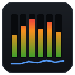
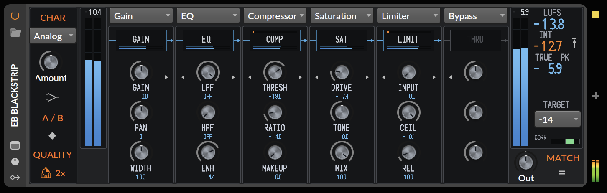
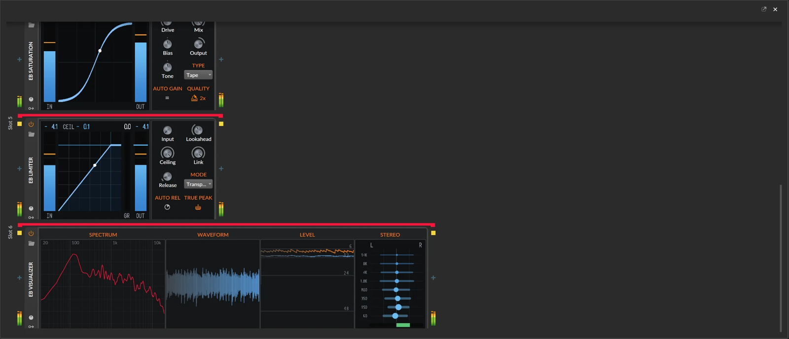
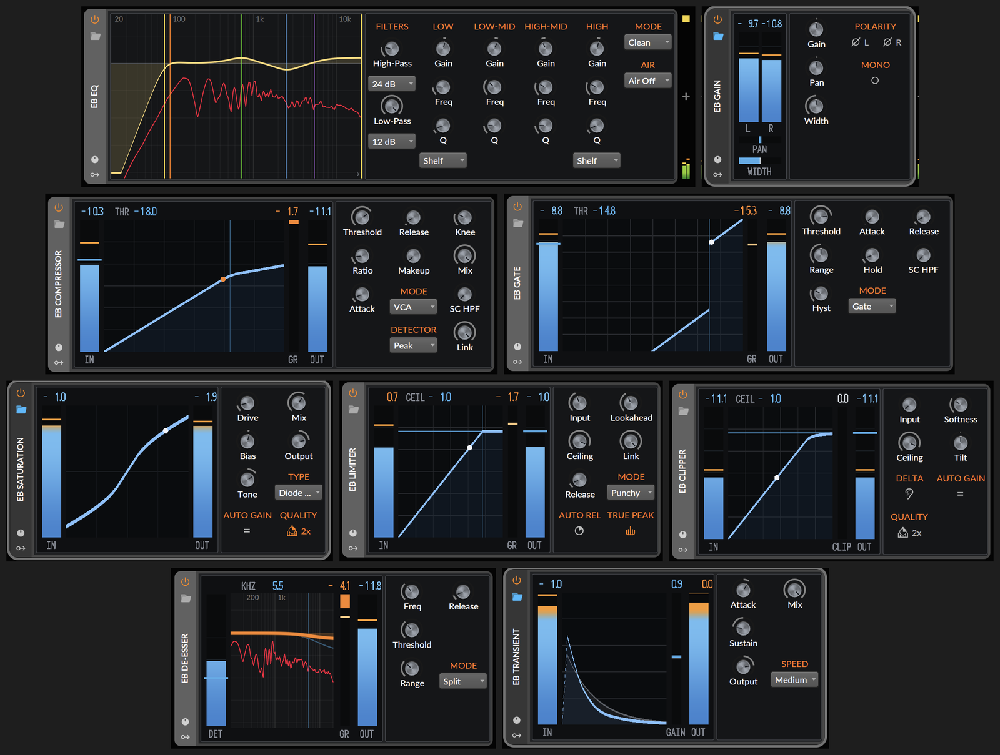
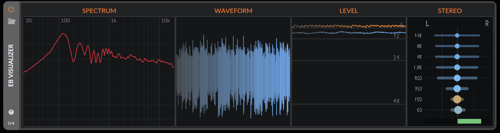
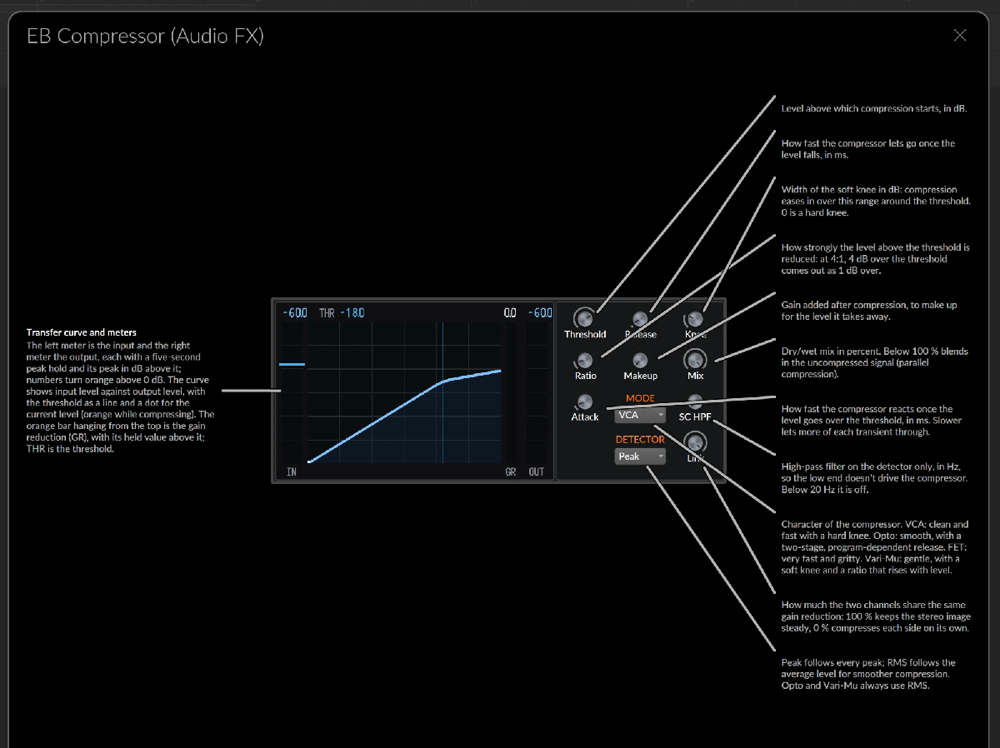

# EB BlackStrip

A channel strip for Bitwig Studio, built from native (Nitro) devices: six slots that each hold one of nine processing
units, a character stage, loudness metering and automatic gain match, all on one device face. A companion mod,
**EB Strip Console**, swaps the units when you change a slot's dropdown and links the strip's knobs to them.

Version 0.9.0. Built and tested with **Bitwig Studio 6.1.7 on macOS** with Patchbay (BML) loader 0.36. Other Bitwig
versions and Windows or Linux are not tested yet (see [Limits](#limits)).

## What you get

**EB BlackStrip** (Container): six slots, left to right. Each slot shows its unit's input and output levels, gain
reduction on dynamics units, and three macro knobs linked to the unit's main controls.

- **Slot dropdown**: Gain, EQ, Compressor, Saturation, Limiter, Gate, De-esser, Transient, Clipper, Visualizer, or
  Bypass. A new strip starts as Gain, EQ, Compressor, Saturation, Limiter.
- **Arrows** beside each slot's top knob swap it with its neighbour, units and settings together.
- **Character** (left column): Clean, Analog, Tube or Tape, after the slots; **Amount** sets how strong; **Input**
  adds it before the slots as well, like a console's input and output stages.
- **A/B**: two complete versions of the strip. The first flip makes B a copy of A.
- **2x**: oversampling for the Character stage and every Saturation and Clipper unit in the strip.
- **Out** and **Match** (right column): Match keeps the output as loud as the input (K-weighted short-term
  loudness), so you hear the processing, not a level change. Out trims on top.
- **Output meter**: peak, short-term loudness (LUFS), integrated loudness (INT, against a target of -14, -16 or
  -23 LUFS, with a reset button), true peak, match gain and stereo correlation.
- **Expanded view**: the window icon in the device header opens all six units side by side, at full size.

**The nine units**, each also usable on its own:

| Unit | What it does |
|---|---|
| EB Gain | Gain, pan, width, polarity per channel, mono check. |
| EB EQ | High-pass and low-pass (6/12/24 dB), four bands (low and high shelf or bell), Clean, Console and Passive modes, Air shelf at 14 kHz, spectrum behind the curve. |
| EB Compressor | VCA, Opto, FET and Vari-Mu modes; threshold, ratio, attack, release, knee, makeup, mix, sidechain high-pass, stereo link, Peak or RMS detector. |
| EB Saturation | Tape, Tube, Soft Clip, Hard Clip, Transformer, Console, Exciter, Diode Si, Diode Ge; drive, bias, tone, mix, auto gain, 2x oversampling. |
| EB Limiter | Transparent, Punchy and Loud modes; ceiling, release, lookahead, stereo link, auto release, true peak. |
| EB Gate | Gate or expander; threshold, range, hysteresis, attack, hold, release, sidechain high-pass. |
| EB De-esser | Split (only the band above the frequency) or Wide; spectrum with the response on top. |
| EB Transient | Attack and sustain, Fast, Medium or Slow. |
| EB Clipper | Ceiling, softness, tilt, Delta (hear what is removed), auto gain, 2x oversampling. |

**EB Visualizer**: spectrum, scrolling waveform, level history (RMS and peak, about six seconds) and a stereo field
of eight bands by pan, level and width, with a correlation bar. It can sit in a strip slot or on its own.

**F1 help**: select any EB device and press F1 for Bitwig's help view, with a description of every control and
display.

**Presets** (in the browser under EB BlackStrip): Default, Vocal, Drum Bus, Bass, Acoustic, Mix Bus, Master. They
also set up the strip's remote control pages.

## Install

You need Bitwig Studio 6.1.7 (macOS) and Patchbay with loader 0.36 or later. Two downloads:

- `eb-strip-console-0.9.0.zip`: the mod.
- `EB-BlackStrip-0.9.0.zip`: the devices and presets.

1. **The mod.** In the Patchbay window, go to **Mods**, click **Add Mod…** and pick `eb-strip-console-0.9.0.zip`
   (don't unpack it). Tick **Device: EB Strip Console**. Ticking it also ticks the frameworks it needs (Actions and
   Menus, Notifications), which come with Patchbay.
2. **The devices.** Unpack `EB-BlackStrip-0.9.0.zip` somewhere permanent, for example your Documents folder. In
   Patchbay, open **Device Folders** under Tools and add its `Devices` folder. Make sure the framework
   **Nitro Devices** is ticked.
3. **The presets.** Copy the `Presets/EB BlackStrip` folder into your Bitwig library's presets folder
   (`~/Documents/Bitwig Studio/Library/Presets/` by default; Bitwig's Settings > Locations shows yours).
4. Press **Load** in Patchbay. In Bitwig, find **EB BlackStrip** in the device browser and drop it on a track.

To update, add the newer mod ZIP the same way (Patchbay keeps your tick), replace the devices folder's contents, and
restart Bitwig.

## Using it

- Change a slot's unit with its dropdown. The strip remembers each slot's last settings per unit type for the
  session, so switching Compressor → Limiter → Compressor brings your compressor settings back.
- Turn the slot's three knobs, or open the unit itself (click the slot in the device chain, or use the expanded view)
  for all its controls.
- Use **Match** while you work so louder doesn't sound better, then turn it off and set **Out** for the level you
  want.
- Put a **Visualizer** in the last slot to watch the strip's output, or on its own on a bus.
- Right-click a track: **EB Strip: Open Expanded View** opens the selected track's strip in the expanded view.

## Limits

- **Bitwig 6.1.7 on macOS only, so far.** The mod is written against 6.1.7's internal names on macOS. Patchbay
  translates mods only from its reference builds (6.1.3 and 6.1.4), so on any other version or platform it shows
  as not available. The devices were compiled for 6.1.7 and are untested elsewhere.
- **Without the mod**, the strip still processes audio and its units still work, but the slot dropdowns, macro
  knobs, swap arrows, A/B, the 2x switch for the slots, the expanded view and the F1 text don't.
- **Session-only memory.** A/B snapshots and remembered settings per unit type last until Bitwig quits; the strip
  itself (units and settings) saves with the project as usual.
- **Saved projects keep their own copy of each device.** After you update the devices, an existing project shows the
  old version until you insert the device again from the browser.
- **2x oversampling** delays the signal by a few samples; the Limiter's lookahead adds its own delay.

## Build from source

The source is in [patchbay-mods](https://github.com/redtile21/patchbay-mods). `channel-strip/` holds the devices,
built with [bitwig-devices-blueprint](https://github.com/polarity/bitwig-devices-blueprint) (Nitro DSP, SkSL display
shaders, Python document builders), the presets and the F1 help text; `eb-strip-console/` holds the mod, built with
Patchbay's mod kit (`build.sh`, JDK 25). `eb-strip-console/release.sh` makes both ZIPs.

License: GPL-3.0, like the rest of the repository.
